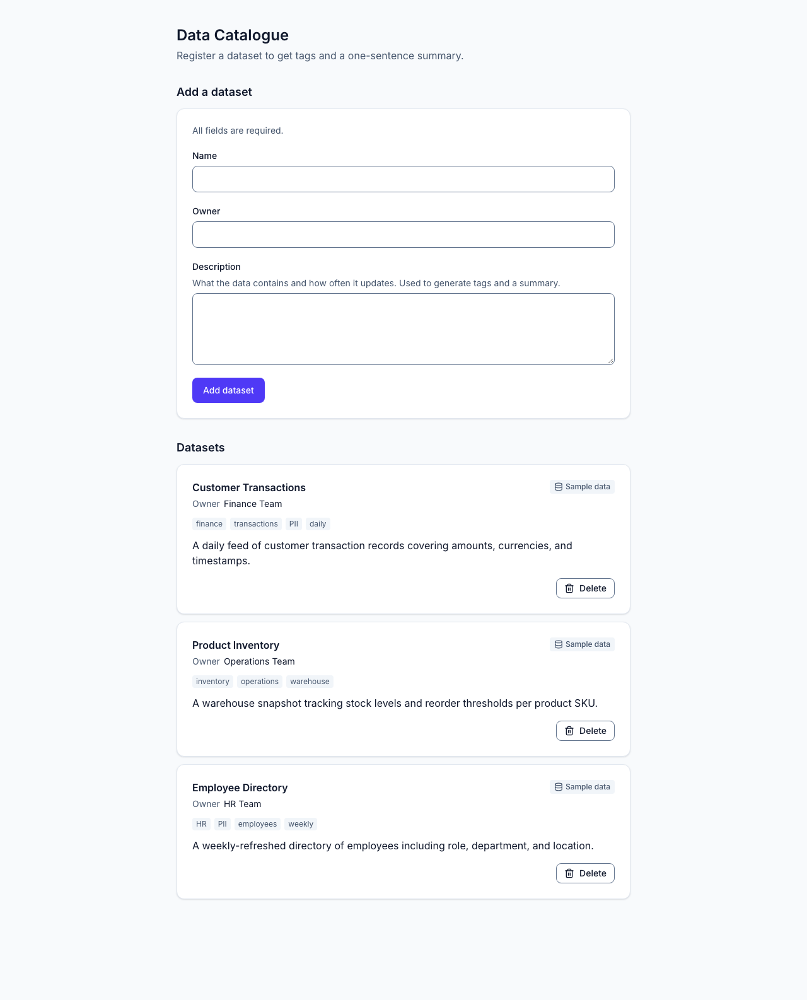

# Data Catalogue

Register a dataset with a name, owner and description, and the API curates it into tags and a one-sentence summary: with Claude when an Anthropic key is configured, and with a deterministic keyword curator otherwise. A FastAPI service and a React single-page app, in one pnpm workspace.



## Prerequisites

- **Node 24** (`.nvmrc`), with **pnpm 11** through Corepack: `corepack enable`.
- **[uv](https://docs.astral.sh/uv/)**, which installs Python 3.14 for the backend by itself.

Nothing else: no Docker, no database. The catalogue lives in process memory and starts from three seed datasets on every restart.

## Quick start

```sh
pnpm bootstrap   # installs both workspaces and Playwright's Chromium; creates backend/.env
pnpm dev         # API on :8000, web on :5173
```

Open http://localhost:5173. The API's interactive docs are at http://localhost:8000/docs. `pnpm dev` prints which curator is active.

## Curation

| Mode                   | How                                                                                                                                                           |
| ---------------------- | ------------------------------------------------------------------------------------------------------------------------------------------------------------- |
| Keyword curator        | The default when no key is set. It scores a weighted taxonomy across name, owner and description, flags PII, detects the update cadence and fills a template. |
| Claude                 | Set `ANTHROPIC_API_KEY` in `backend/.env` (a key exported in your shell also counts), then restart `pnpm dev`.                                                |
| Force the keyword mode | `CATALOGUE_CURATION_PROVIDER=keyword pnpm dev`, even with a key set.                                                                                          |
| See the failure path   | `pnpm dev:degraded` (API :8100, web :5180): every curation fails offline, and the record is still saved, marked "Curation failed".                            |

If your key is not scoped to a workspace, Anthropic answers every call with a 400 until you also set `ANTHROPIC_WORKSPACE_ID`. Other settings, with their defaults, are in `backend/.env.example` and [docs/architecture.md](docs/architecture.md#configuration).

The keyword curator on a sample dataset:

```json
{
  "name": "Trade Confirmations",
  "tags": ["trading", "finance", "settlements", "daily"],
  "summary": "A daily export of confirmed trades covering instrument type, counterparty, and notional value.",
  "curation": { "status": "completed", "provider": "keyword", "detail": null }
}
```

Claude is called with structured outputs, so its reply is parsed into the same shape. A curation that fails (a timeout, a rate limit, Anthropic unavailable or rejecting the request, a refusal, or a reply that can't be used) never loses the record: it is saved with `curation.status: "failed"`, empty tags, no summary, and a `detail` the UI shows.

## Constraints and how they are met

### Validation checklist

| Checklist item                                             | Proved by                                                                                                                            |
| ---------------------------------------------------------- | ------------------------------------------------------------------------------------------------------------------------------------ |
| `GET /datasets` returns 3 pre-loaded entries               | `test_get_datasets_returns_all_three_preloaded_entries_on_startup` (`backend/tests/api/test_datasets.py`); `pnpm verify:api` check 1 |
| `POST` with the test payload returns 201, tags, summary    | `test_post_datasets_with_the_test_payload_returns_201_with_tags_and_summary_populated`; `pnpm verify:api` check 2                    |
| `DELETE /datasets/1` returns 200 and the entry is gone     | `test_delete_datasets_1_returns_200_and_the_entry_no_longer_appears_in_a_subsequent_get`; `pnpm verify:api` checks 3 and 4           |
| A missing name or description returns 400 with a message   | `test_post_datasets_with_a_missing_name_or_description_returns_400_with_an_error_message`; `pnpm verify:api` checks 5 and 6          |
| The page loads showing all three entries                   | `frontend/e2e/checklist.spec.ts` and `frontend/src/app/app.test.tsx`, each with one test named after this item                       |
| The test payload adds a fourth entry with tags and summary | the same two files, plus the keyboard-only version in `frontend/e2e/keyboard.spec.ts`                                                |
| Delete removes the entry without a page refresh            | the same two files; the E2E test checks a `window` sentinel survives and no navigation happens                                       |
| An empty name or description shows an inline error         | the same two files                                                                                                                   |

**Stricter than the checklist:** `owner` is required too. The UI marks all three fields as required, and the API returns a 400 for a missing owner as it does for the other two. The API also rejects unknown fields and values over the documented length limits, and every error is an [RFC 9457](https://www.rfc-editor.org/rfc/rfc9457) `application/problem+json` body.

### Rubric

| Area                    | Where                                                                                                                                                                                                                                         |
| ----------------------- | --------------------------------------------------------------------------------------------------------------------------------------------------------------------------------------------------------------------------------------------- |
| Layered backend         | `app → api → services → curation \| repositories → domain → core`, enforced by four import-linter contracts in `backend/pyproject.toml`                                                                                                       |
| Validation              | `backend/src/catalogue/api/schemas.py`: trimmed, length-limited, unknown fields rejected; the frontend's zod schema is tested against the same OpenAPI limits                                                                                 |
| Error handling          | `backend/src/catalogue/api/problems.py`: problem details for 400, 404, 405 and unhandled 500s (with CORS headers, so the browser can read them)                                                                                               |
| Graceful AI degradation | `CurationService` in `backend/src/catalogue/curation/service.py` turns every failure into a saved record with a readable detail; `test_a_failed_curation_still_saves_the_dataset_and_returns_201`; `pnpm verify:api --degraded`               |
| Prompt quality          | `backend/src/catalogue/curation/prompt.py`: the role, the dataset as untrusted input, the tag facets in order, PII guidance, the summary rules, and the three seeds as worked examples                                                        |
| Structured output       | `backend/src/catalogue/curation/anthropic_provider.py` parses Claude's reply into `CurationDraft` through structured outputs; a refusal or a truncated or invalid reply becomes a named failure                                               |
| Mock quality            | `backend/src/catalogue/curation/keyword_provider.py`, pinned by golden tests that include the three seeds and the test payload                                                                                                                |
| Component breakdown     | `frontend/src/components/ui/` (feature-agnostic primitives) and `frontend/src/features/datasets/` (`api/`, `hooks/`, `components/`)                                                                                                           |
| State management        | TanStack Query owns all server state (`frontend/src/features/datasets/hooks/use-datasets.ts`): the 201 body is written to the cache, and delete is optimistic and restores the row if it fails                                                |
| User feedback           | A pending button with status text while Claude works, inline field errors (including the server's), an inline alert for any other rejected create, toasts for every save and delete outcome, and loading, empty and error states for the list |
| API separation          | Types generated from the backend's OpenAPI document (`pnpm gen:api`), one typed client, and one module that calls it; `pnpm check:api` fails if the committed types drift                                                                     |
| Accessibility           | WCAG 2.2 AA: axe in every component state and in E2E, a keyboard-only E2E pass, specified focus moves, a confirm dialog for delete, and reflow at 320 px. The contract is in [specs/datasets-ui.md](specs/datasets-ui.md)                     |

## Testing

| Command           | Runs                                                                                                                                                                             |
| ----------------- | -------------------------------------------------------------------------------------------------------------------------------------------------------------------------------- |
| `pnpm check`      | Backend: ruff, import-linter, mypy `--strict`, pytest and schemathesis at 95 % coverage, OpenAPI drift. Frontend: ESLint, Prettier, `tsc`, Vitest Browser Mode at 95 % coverage. |
| `pnpm test:e2e`   | Playwright against the production build, on its own servers (:8001, :4173), with the keyword curator pinned                                                                      |
| `pnpm verify:api` | The API checklist against a fresh server; `--degraded` for the failure path, `--provider anthropic` for one live Claude call                                                     |

Husky runs lint-staged and commitlint on commit and `pnpm check` on push. CI runs the backend checks, the frontend checks with a production build, and an E2E job with both `verify:api` modes.

The app is also verified in a real browser through Claude in Chrome with the `/verify-ui` skill. The latest report is [docs/verification.md](docs/verification.md).

## Project layout

```
backend/    FastAPI app (src/catalogue) with its pytest and schemathesis suites
frontend/   React app with its Vitest and Playwright suites
specs/      one behaviour contract per subsystem
docs/       architecture and the latest browser-verification report
scripts/    the Node scripts behind the root commands
```

## Decisions

The system view, the layers, configuration and the decisions that cut across the codebase, with what was rejected and why, are in [docs/architecture.md](docs/architecture.md). Each subsystem's behaviour and local decisions are in [specs/](specs/README.md).
