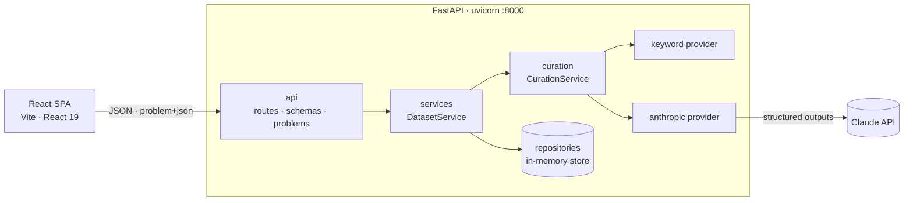
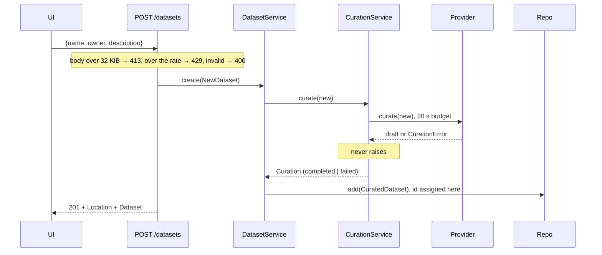

# Architecture

> This is the system view and the decisions that cut across it. Behaviour contracts, and the decisions local to a subsystem, live in [`specs/`](../specs/README.md).

A single-page data catalogue. Users register a dataset (name, owner, description) and the API curates it into tags and a one-sentence summary: with Claude when a key is configured, and with a deterministic keyword curator otherwise. The brief's rubric and validation checklist are the acceptance criteria, and [`README.md`](../README.md) maps each checklist item to the test that proves it.

Out of scope: persistence beyond process memory, authentication, editing, re-curation, search, pagination, dark mode.

## System





## Repository layout

```
backend/              FastAPI app (uv project, package src/catalogue)
frontend/             React app with its Vitest and Playwright suites
specs/                one behaviour contract per subsystem; read before changing that subsystem
docs/                 this file, the latest browser-verification report and its screenshots
.claude/              project skills and agents
.github/              CI workflow and its composite setup action
scripts/              dev.mjs runs API and web together; gen-api.mjs runs codegen and the drift check; ensure-env.mjs creates backend/.env
README.md             reviewer entry point: prerequisites, run, test, how the brief is met
CLAUDE.md             entry point for AI sessions: commands, where truth lives, rules
package.json          root scripts; husky, lint-staged, commitlint, Prettier
```

## Backend

### Layers

`app → api → services → curation | repositories → domain → core`

A module imports only from layers below it, and `curation` and `repositories` never import each other. Only `api` and `app` import FastAPI or Starlette, only `curation` imports the Anthropic SDK, `domain` imports no framework at all (not even Pydantic), and only `app.py` and `curation/factory.py` name concrete implementations. import-linter enforces these contracts in `pnpm check`.

| Package         | Owns                                                                                                               |
| --------------- | ------------------------------------------------------------------------------------------------------------------ |
| `app.py`        | `create_app()`, the composition root: settings, lifespan, middleware, routers. `export_openapi()` for codegen.     |
| `api/`          | Routes, camelCase wire schemas, problem+json handlers, dependency providers, request limits, OpenAPI customisation |
| `services/`     | `DatasetService`: list; create (curate, then store); delete (missing id raises a domain error)                     |
| `curation/`     | Provider protocol, Claude and keyword providers, the `CurationService` failure boundary, normalisation, prompt     |
| `repositories/` | `DatasetRepository` protocol, the in-memory implementation, seed records                                           |
| `domain/`       | Frozen dataclasses (`NewDataset`, `Curation`, `CuratedDataset`, `Dataset`), field limits, literal types, errors    |
| `core/`         | Settings (pydantic-settings) and logging                                                                           |

### Models

Domain types are frozen, slotted dataclasses. The in-memory store hands out the objects it holds, so immutability is what stops a caller mutating the catalogue. `NewDataset` checks the field length limits itself, because they bound what a curation costs whoever builds one; the wire schema uses the same constants, so a client hears about a limit as a field error first. `Curation` is the one shape of a curation outcome, tags and summary included: `CurationService` returns it and the store keeps it inside `Dataset`. Wire types are Pydantic models that own every HTTP concern (aliases, trimming, the character rules, `extra="forbid"`, OpenAPI examples) and map from domain objects through `from_attributes`. Routes build `NewDataset` from the validated body, so services never see a Pydantic model.

### Dependency injection

`create_app(settings=None, *, repository=None, curation_provider=None, rate_limiter=None, clock=utc_now)`. The lifespan builds whatever was not injected and yields it as lifespan state, so every startup begins with an empty rate limiter as well as the seeds. The provider comes from `open_curation_provider(settings)`, an async context manager that also closes the SDK's HTTP client on shutdown. `api/deps.py` is the only reader of that state. Tests pass fakes as arguments and still run the real lifespan through `TestClient`, so there are no `dependency_overrides`. Uvicorn starts the app with `--factory`, so importing the module has no side effects.

### Errors

Every non-2xx response is RFC 9457 problem+json, except the `400 text/plain` that `CORSMiddleware` gives a preflight it rejects. Three framework overrides are needed to get there: 400 instead of 422 for invalid bodies, a complete `Allow` header on 405, and CORS headers on unhandled 500s. The body size limit is a middleware of the app's own for the same reason: its 413 is raised inside the app, so it is a problem with CORS headers. The mapping and the reasons are in [specs/api-contract.md](../specs/api-contract.md).

### Request limits

A body over 32 KiB is refused before it is buffered, `POST /datasets` has a token-bucket rate limit per client address, and the Claude provider caps the calls in flight. Together they bound what one client, and all clients together, can spend on Claude. Distributed denial of service is left to the edge. The limits are in [specs/api-contract.md](../specs/api-contract.md#request-limits) and the concurrency cap in [specs/curation.md](../specs/curation.md#claude-request).

### State and concurrency

There is one uvicorn worker and routes are async. The repository protocol is `async`, so a store that does I/O could implement it, but the in-memory store never awaits inside a method, so each call runs to completion on the event loop without a lock; its tests drive every call in one step to prove it. `add()` takes a `CuratedDataset`, assigns the id and stores the record in one call (INSERT … RETURNING), so the protocol has no read-then-write step that any implementation would need to lock. The rate limiter is synchronous for the same reason. Id and restart behaviour are in [specs/api-contract.md](../specs/api-contract.md#behaviour-contract).

### Configuration

pydantic-settings reads the environment first and then `backend/.env`, resolved from the package rather than the working directory. An unknown key in `backend/.env` fails startup, so a misspelt `CATALOGUE_CURATION_PROVIDER` cannot silently fall back to `auto`. The startup message lists each failing setting and its error but never the value, because a misspelt key's value may be the API key. `.env.example` leaves the code defaults commented out, so a later change to a default reaches existing checkouts. App settings use the `CATALOGUE_` prefix. The Anthropic variables keep their conventional names and reach the SDK only through Settings ([provider selection](../specs/curation.md#provider-selection)).

| Variable                                 | Default                     | Purpose                                                                                             |
| ---------------------------------------- | --------------------------- | --------------------------------------------------------------------------------------------------- |
| `CATALOGUE_CURATION_PROVIDER`            | `auto`                      | `auto`, `keyword` or `anthropic`                                                                    |
| `ANTHROPIC_API_KEY`                      | unset                       | Enables Claude under `auto`. A key exported in the shell counts too.                                |
| `ANTHROPIC_BASE_URL`                     | `https://api.anthropic.com` | API host                                                                                            |
| `ANTHROPIC_WORKSPACE_ID`                 | unset                       | Workspace for a key not scoped to one; sent as the `anthropic-workspace-id` header                  |
| `CATALOGUE_ANTHROPIC_MODEL`              | `claude-opus-5-5`           |                                                                                                     |
| `CATALOGUE_ANTHROPIC_TIMEOUT_SECONDS`    | `20`                        | Total curation budget, retries and waiting for a free slot included                                 |
| `CATALOGUE_ANTHROPIC_MAX_CONCURRENCY`    | `4`                         | Claude calls in flight at once, 1 to 64; further creates queue inside the budget                    |
| `CATALOGUE_CREATE_RATE_LIMIT_PER_MINUTE` | `10`                        | `POST /datasets` per client address per minute, with bursts of the same size. Playwright sets 1000. |
| `CATALOGUE_KEYWORD_DELAY_MS`             | `0`                         | Simulated keyword latency. `.env.example` sets 1200 so the pending state is visible in dev.         |
| `CATALOGUE_CORS_ORIGINS`                 | `["http://localhost:5173"]` | Exact origins: scheme and host, no trailing slash                                                   |
| `CATALOGUE_LOG_LEVEL`                    | `INFO`                      |                                                                                                     |
| `VITE_API_BASE_URL` (frontend)           | `http://localhost:8000`     | Committed in `frontend/.env`. `scripts/dev.mjs` and Playwright override it per profile.             |

## AI curation

Curation runs inside `POST /datasets` before the record is stored, and it never decides whether the record is stored. `CurationService` is the failure boundary. Providers raise typed `CurationError`s, and the service turns every failure, foreseen or not, into a saved record with `curation.status: "failed"` and a message the user can read. Claude is called with structured outputs. The keyword provider scores a facet taxonomy and fills a summary template. Provider selection, the request, the prompt, normalisation, the failure table and the mock's rules are in [specs/curation.md](../specs/curation.md).

## Frontend

### Structure

```
src/
  app/                 providers, query client, error boundary, page shell
  components/ui/       Button, Field, Badge, Spinner, Alert, ConfirmDialog; feature-agnostic
  features/datasets/
    api/               datasets service over the typed client; query-key factory
    hooks/             useDatasets, useCreateDataset, useDeleteDataset
    components/        form, list, card, tag list, curation badge, list states
  lib/api/             openapi-fetch client, ApiError, generated schema.gen.ts
  lib/forms/           server field errors mapped into react-hook-form
  lib/env.ts           the only reader of VITE_* variables, validated with zod
  test/                Vitest setup, render helpers, axe, MSW
```

Dependencies point one way: features may use `components/ui` and `lib`, and neither of those knows about datasets. There is no router, no client-state store and no barrel files.

### Data flow

- **API layer.** openapi-typescript generates types from the backend's OpenAPI document, and calls go through openapi-fetch. `datasetsApi` is the only module that calls the client. `unwrap()` turns error responses, network failures and success bodies that are not JSON into one `ApiError`.
- **Server state.** TanStack Query owns everything fetched, and nothing else holds server data.
- **Forms.** react-hook-form with a zod schema that mirrors the API's field limits.

Cache writes, optimistic delete, retries, copy, focus rules and the accessibility contract are in [specs/datasets-ui.md](../specs/datasets-ui.md). Tokens and design principles are in [specs/styling.md](../specs/styling.md).

### Toolchain

React 19 · Vite 8 (Rolldown) · TypeScript 6 · Tailwind CSS 4 · TanStack Query · react-hook-form with zod · tailwind-variants · sonner · lucide-react. Exact versions are in `frontend/package.json`. Schemas use `zod/mini`: classic zod's methods bring along JSON-schema and locale code the app never calls, about 60 kB of the bundle, and ESLint refuses an import of `zod` itself. React Compiler runs in dev and production builds through `@rolldown/plugin-babel`. It is off under test ([why](../specs/quality-gates.md#invariants--decided-points)).

## Quality

There are seven test layers:

- backend unit (pytest);
- backend API (pytest with `TestClient`);
- contract (schemathesis);
- frontend unit and component (Vitest Browser Mode with MSW and axe);
- E2E (Playwright on the production build);
- live API (`verify_api.py`);
- agentic (Claude in Chrome via `/verify-ui`).

Coverage is gated at 95 % on both sides. Husky runs lint-staged on commit, commitlint on the message, and `pnpm check` on push. CI runs the same checks, split into backend and frontend jobs, plus the production build and E2E. What each layer proves, the hooks, the CI jobs and the E2E harness are in [specs/quality-gates.md](../specs/quality-gates.md).

## Working on this repo with Claude Code

`specs/` holds one living contract per subsystem, with its lifecycle in [specs/README.md](../specs/README.md). The rules that hold everywhere, the commands and where each fact lives are in [`CLAUDE.md`](../CLAUDE.md), and `backend/CLAUDE.md` and `frontend/CLAUDE.md` load when Claude Code works in those directories. The `verify-api` and `verify-ui` skills and the `spec-auditor` agent, with their limits, are in [specs/quality-gates.md](../specs/quality-gates.md#claude-in-chrome-verification).

## Decisions

Subsystem decisions live in each spec's _Invariants & decided points_.

| Decision                                                  | Why                                                                                                                     | Rejected                                                        |
| --------------------------------------------------------- | ----------------------------------------------------------------------------------------------------------------------- | --------------------------------------------------------------- |
| Monorepo run by root scripts                              | One `pnpm bootstrap` and one `pnpm dev`, needing Node, pnpm and uv but no container runtime                             | A compose file                                                  |
| Python 3.14 via uv; FastAPI pinned to a minor version     | uv provisions Python itself. FastAPI 0.x makes breaking changes in minor releases.                                      | Poetry; requirements.txt                                        |
| `mypy --strict` with the Pydantic plugin                  | Understands pydantic-settings and Pydantic models through the plugin                                                    | pyright (false positives on `Settings` construction); ty (beta) |
| Layering enforced by import-linter                        | The rubric grades separation of concerns. An executable contract keeps it from depending on review.                     | Convention only                                                 |
| RFC 9457 problem details for every error                  | One standard shape that any client can parse                                                                            | An ad-hoc error envelope                                        |
| camelCase on the wire                                     | Matches the TypeScript consumer. Pydantic aliases keep Python snake_case.                                               | snake_case JSON                                                 |
| Synchronous curation; `201` whatever the curation outcome | The brief requires tags and summary in the 201 response, and a failed AI call must not lose the record.                 | Background curation with polling                                |
| `anthropic` SDK 2.x                                       | The major that defaults to API version 2026-10-21. The call shape is the same as 1.17.                                  | 1.17                                                            |
| `claude-opus-5-5` at `effort: "low"`, configurable        | Anthropic's recommended model as of 2026-10. Curation is a short classification, so low effort bounds latency and cost. | —                                                               |
| Types generated from OpenAPI, committed, drift-checked    | Backend and frontend cannot diverge silently, and frontend work does not need Python.                                   | Hand-written types; runtime response validation                 |
| TypeScript 6, not 7                                       | TypeScript 7 (native) has no compiler API, and typescript-eslint and openapi-typescript both depend on one.             | 7                                                               |
| Spec-driven documentation                                 | Sessions, human or AI, inherit decisions from one home per fact instead of re-deriving them.                            | One long design document                                        |

## Risks

- **`anthropic` 2.x was first released on 2026-10-21.** The lockfile pins it, and 1.17 has the same call shape if a regression appears.
- **Tooling ahead of its peers.** `eslint-plugin-jsx-a11y` declares ESLint ≤ 9 and `openapi-typescript` declares TypeScript 5; both run correctly on ESLint 10 and TypeScript 6, with the peer overrides recorded in `pnpm-workspace.yaml`. `@types/eslint-plugin-jsx-a11y` depends on ESLint 9 outright, so an override there pins it to the ESLint in use, and an ESLint upgrade changes both. React Compiler 1.0 runs on Babel 7, as its own dependency requires.
