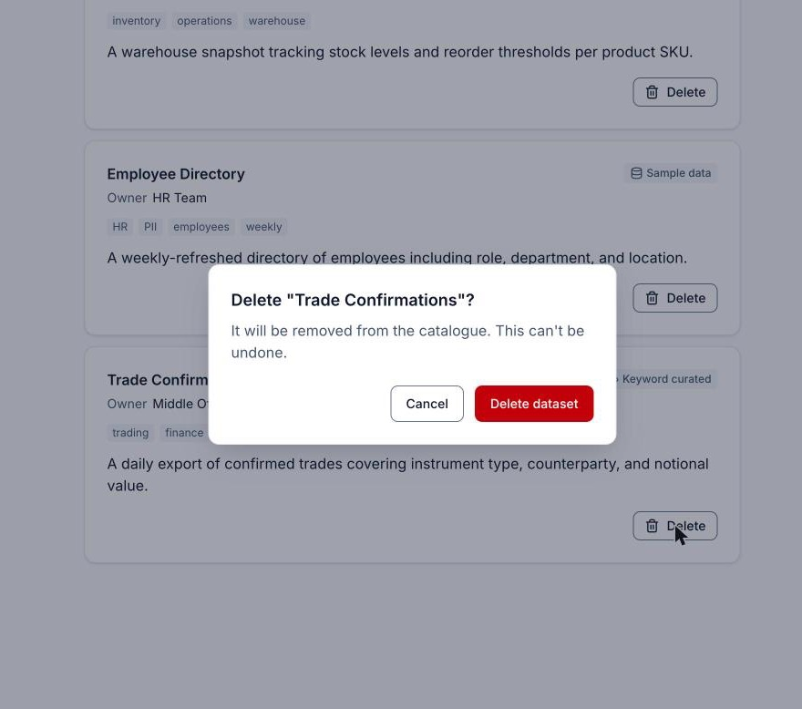
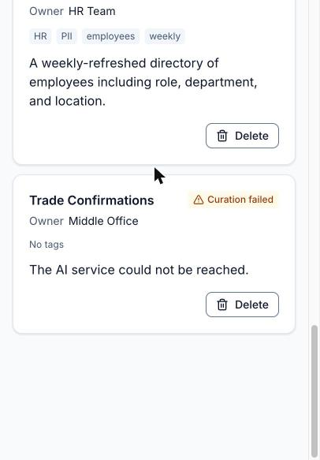
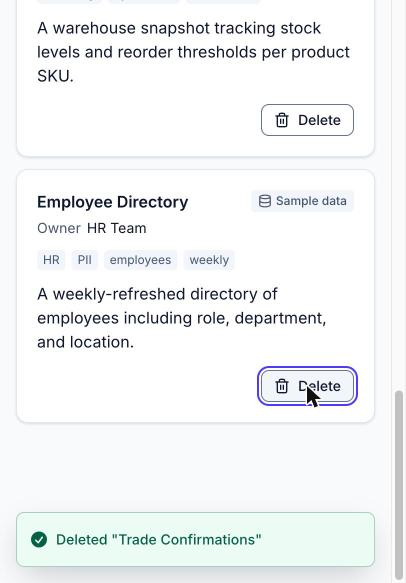

# Browser verification

The latest `/verify-ui` run: the `ui-tester` agent driving the app in Chrome through Claude in Chrome, following `.claude/skills/verify-ui/SKILL.md`. What each check covers is in [specs/quality-gates.md](../specs/quality-gates.md#claude-in-chrome-verification).

- **Date:** 2026-10-26
- **Commit:** `4319ac2`, clean tree
- **Curation provider:** `keyword`. The run started its own servers with `/verify-ui keyword`, so no step called Claude. A live Claude pass is pending an `ANTHROPIC_WORKSPACE_ID` for the configured key.
- **Widths:**
  - 1040 × 778 for steps 1 to 6;
  - 406 × 583, the narrowest the window reached, for step 7 and a repeat of the reflow and toast checks;
  - a same-origin iframe 320 px wide, for reflow.

**Since this run:** `65513fd` fixed the first advisory finding below, and the skill and agent were updated from the run's notes on tooling. Neither change alters a result here.

## Results

| Check                                    | Result | Evidence                                                                                                                                                                                                                                                                                                                                           |
| ---------------------------------------- | ------ | -------------------------------------------------------------------------------------------------------------------------------------------------------------------------------------------------------------------------------------------------------------------------------------------------------------------------------------------------- |
| 1. Preflight                             | PASS   | Nothing answered on :8000 or :5173, so the run started the API (keyword) and Vite as separate processes. `/health` reported `keyword`, and `GET /datasets` returned the three seeds.                                                                                                                                                               |
| 2.1 Seeds on load                        | PASS   | Row headings in order: Customer Transactions, Product Inventory, Employee Directory, each with "Sample data", tags and summary. `<title>Data Catalogue</title>`, `lang="en"`.                                                                                                                                                                      |
| 2.2 Inline errors                        | PASS   | The empty submit showed "Enter a name", "Enter an owner" and "Enter a description". Each field had `aria-invalid="true"` and its message in `aria-describedby`. Focus was on Name, and no request reached `/datasets`. The errors cleared while typing.                                                                                            |
| 2.3 The test payload adds a 4th entry    | PASS   | While pending: "Saving and curating…" with `aria-disabled` (not `disabled`), focus kept on the button, read-only fields, and the 20-second status text. Then a 201 and a fourth row: "Keyword curated", tags trading, finance, settlements, daily, and a one-sentence summary. The success toast showed, the form was empty and focus was on Name. |
| 2.4 Delete without a refresh             | PASS   | The modal `alertdialog` had the spec's copy, with Cancel focused. Esc deleted nothing and returned focus to the row's Delete button. Confirming sent `DELETE /datasets/4` (200) and the row went. The `window` sentinel survived, the success toast showed, focus moved to "Employee Directory", and the API was back to the seeds.                |
| 3. Skip link                             | PASS   | "Skip to datasets" was visible with a ring when focused, and Enter moved focus to the Datasets heading.                                                                                                                                                                                                                                            |
| 3. Focus ring at every stop              | PASS   | Screenshotted at each of 15 stops, from the skip link through the form, the row buttons and the dialog. Each showed the 2 px focus-colour outline at a 2 px offset.                                                                                                                                                                                |
| 3. Keyboard add and delete               | PASS   | Added with Tab and Enter only, and focus returned to Name. Space opened the dialog with Cancel focused, Esc returned focus to Delete, then Enter, Tab and Enter deleted the row, with focus on the neighbouring heading.                                                                                                                           |
| 3. Focus never on `body`                 | PASS   | Never in the page. Tab past the dialog's last button moves focus to the browser's own UI (native `showModal()`, `document.hasFocus()` false), and the next Tab returns to Cancel.                                                                                                                                                                  |
| 4. Landmarks and headings                | PASS   | One `header`, one `main`, both sections labelled by their `h2`, one `h1`. Heading order h1, h2, h2, h3 × 3. No positive `tabindex`. Rows are `li > article[aria-labelledby]`, and tags are a labelled list.                                                                                                                                        |
| 4. Accessible names                      | PASS   | Every name in the spec's list matched. A row's button is "Delete {name}": the visible label plus the name in visually hidden text. Icons are `aria-hidden`.                                                                                                                                                                                        |
| 4. Live regions                          | PASS   | Both `role="status"` regions were mounted and empty before their text changed. Toasts sit in sonner's polite live region.                                                                                                                                                                                                                          |
| 4. Reflow                                | PASS   | No horizontal overflow at 1040 px, 406 px or 320 px. At 320 px the page is a single column with nothing clipped.                                                                                                                                                                                                                                   |
| 4. Toasts never cover the focused Delete | PASS   | At all three widths the last row's focused Delete button sat clear of the toast stack, and its centre hit the button itself. See the screenshot below.                                                                                                                                                                                             |
| 5. API down on load, then Try again      | PASS   | With the API stopped and the page reloaded, the alert showed "Could not reach the server. Check your connection and try again." and the status region announced it. Restarted the API and pressed Try again: loading, then the seeds, with focus on the Datasets heading.                                                                          |
| 5. Deleted elsewhere                     | PASS   | Created a record with `curl`, reloaded, deleted it with `curl`, then deleted it in the page: a 404, the info toast `"Verify UI deleted elsewhere" was already removed`, and the row went.                                                                                                                                                          |
| 6. Console errors                        | PASS   | None, in either tab.                                                                                                                                                                                                                                                                                                                               |
| 7. Degraded path                         | PASS   | Against `pnpm dev:degraded` the row showed "Curation failed", "No tags" and the detail "The AI service could not be reached." The warning toast `Saved "Trade Confirmations" without AI tags` had a 24 px close button. Deleted the row afterwards.                                                                                                |
| Finish                                   | PASS   | Both catalogues held only the seeds. All tabs were closed and every process the run started was stopped.                                                                                                                                                                                                                                           |

## Accessibility findings

No failures. Two advisory notes:

1. **The skip link scrolled the Datasets heading flush to the top of the viewport,** so the top edge of its focus ring touched the edge (2.4.7, still met). Fixed in `65513fd` with a scroll margin, pinned by a test in `frontend/src/app/app.test.tsx`.
2. **Tab past the dialog's last button reaches the browser's UI** before cycling back to Cancel. This is native `showModal()` behaviour, not a trap (2.1.2 and 2.4.3 met), so it stays as is.

## Screenshots

The delete dialog at 1040 px:

At 406 px, a failed curation from the degraded path, and the last row's focused Delete button clear of a toast:

  
  

