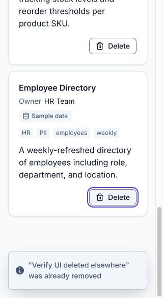

# Browser verification

The latest `/verify-ui` run: the skill driving the app in Chrome through Claude in Chrome, in a forked subagent. What each check covers is in [specs/quality-gates.md](../specs/quality-gates.md#claude-in-chrome-verification).

- **Date:** 2026-10-26
- **Commit:** `b47dcbb`. The run owned its servers and started from a clean tree.
  - The edits now in `ecb377c` landed while it ran, and nothing under `frontend/` changed.
  - The API restarted for step 5 loaded `ecb377c`'s prompt rule against repeated tags, and curated only the deleted-elsewhere record. The checklist and keyboard entries were curated with `b47dcbb`'s prompt.
- **Curation provider:** `anthropic` (`claude-opus-5-5`), from `backend/.env`. Three billed calls: the checklist entry, the keyboard pass's entry and the deleted-elsewhere record.
- **Widths:**
  - 998 px: the checklist, the keyboard pass, landmarks, names and live regions.
  - 406 px, the narrowest the window would go: reflow, the API-down check and the degraded path.
  - A same-origin iframe 320 px wide: reflow, deleted elsewhere, and the toast check.

## Results

| Check                                       | Result | Evidence                                                                                                                                                                                                                                                                                     |
| ------------------------------------------- | ------ | -------------------------------------------------------------------------------------------------------------------------------------------------------------------------------------------------------------------------------------------------------------------------------------------- |
| Preflight                                   | PASS   | Nothing answered on :8000 or :5173. The run started uvicorn and Vite as separate processes, and `GET /datasets` returned the three seeds.                                                                                                                                                    |
| Seeds on load                               | PASS   | Row headings in order: Customer Transactions, Product Inventory, Employee Directory, each marked "Sample data". `<title>Data Catalogue</title>`, `lang="en"`.                                                                                                                                |
| Inline errors on an empty submit            | PASS   | "Enter a name", "Enter an owner" and "Enter a description". Each field had `aria-invalid="true"` and its error in `aria-describedby`; Description's also had its hint. Focus went to Name, and no request reached the API.                                                                   |
| Pending state                               | PASS   | Read in the same batch as the click: "Saving and curating…" with a spinner, `aria-disabled="true"` and not `disabled`, and focus kept on the button. The fields were read-only and the status line showed the 20-second text. A second click sent nothing.                                   |
| The test payload adds a fourth entry        | PASS   | `POST /datasets` 201. The row showed "Curated by Claude", the tags trading, trades, confirmations and daily, and the summary "A daily export of confirmed trades covering instrument type, counterparty, notional value, and settlement date." The form emptied, and focus returned to Name. |
| Success toast on create                     | PASS   | `Added "Trade Confirmations"`. It was seen in the keyboard pass's identical create; the checklist's DOM read came after the 5 s toast had gone.                                                                                                                                              |
| Delete dialog copy and initial focus        | PASS   | A modal `alertdialog` titled `Delete "Trade Confirmations"?`, with the spec's text and Cancel, then "Delete dataset". Cancel had focus.                                                                                                                                                      |
| Esc closes without deleting                 | PASS   | Four rows remained in the page and the API, and focus returned to "Delete Trade Confirmations".                                                                                                                                                                                              |
| Delete without a refresh                    | PASS   | The row went at once. The `window` sentinel survived with one navigation entry, and `Deleted "Trade Confirmations"` showed. Focus moved to "Employee Directory", the previous row, and the API was back to the seeds.                                                                        |
| Keyboard: skip link                         | PASS   | It was the first Tab stop, with its ring. Enter focused the Datasets heading, ring in view (top 16 px), and the next Tab reached "Delete Customer Transactions".                                                                                                                             |
| Keyboard: add and delete                    | PASS   | Added with Tab and Enter only: focus stayed on the pending button, then returned to Name. Space opened the dialog on Cancel, and Esc returned focus to Delete. Enter, Tab and Enter deleted the row, with focus on the neighbouring heading.                                                 |
| Keyboard: focus ring at every stop          | PASS   | `:focus-visible` with the 2 px focus-colour outline at a 2 px offset, inside the viewport, at every stop.                                                                                                                                                                                    |
| Focus never on `body` while the page has it | PASS   | A watcher polling every 30 ms recorded none. Tab past the dialog's last button goes to the browser's UI (native `showModal()`), and the next Tab returns to Cancel.                                                                                                                          |
| Landmarks and headings                      | PASS   | One `header` with the `h1`, one `main`, two sections labelled by their `h2`. Headings h1, h2, h3 with no skipped level. No positive `tabindex`.                                                                                                                                              |
| Accessible names                            | PASS   | Every name in the spec's list, checked in the DOM, including sonner's "Notifications alt+T" region and "Close toast" button. A row's button is "Delete" plus the name in visually hidden text.                                                                                               |
| Row structure                               | PASS   | `li > article[aria-labelledby]`, a focusable `h3`, the owner as a `dl` pair, tags as `ul aria-label="Tags"`. A failed row shows "No tags" with no empty list.                                                                                                                                |
| Live regions                                | PASS   | Both `role="status"` regions were mounted and empty before their text changed. The toaster is `aria-live="polite"`.                                                                                                                                                                          |
| Target sizes                                | PASS   | Add dataset 115 × 40, row Delete 93 × 32, Try again 88 × 32, and the toast close button 24 × 24 (from `index.css`).                                                                                                                                                                          |
| Reflow                                      | PASS   | No horizontal overflow at 406 px or in the 320 px iframe, and nothing extends past the right edge.                                                                                                                                                                                           |
| Toasts never cover the focused Delete       | PASS   | At 320 px and at 406 px, right after a confirmed delete, the last row's focused Delete button sat clear of the toast (see below).                                                                                                                                                            |
| API down on load, then Try again            | PASS   | With the API stopped, the skeleton showed, then after the retries "Couldn't load datasets" with "Could not reach the server. Check your connection and try again." After restarting the API, Try again showed loading, then the seeds, with focus on the Datasets heading.                   |
| Deleted elsewhere                           | PASS   | Created with `curl` (curated by Claude), reloaded, deleted with `curl`, then deleted in the page: a 404, the info toast `"Verify UI deleted elsewhere" was already removed`, and the row went.                                                                                               |
| Console errors                              | PASS   | None. Only Vite's connection lines and React's DevTools notice.                                                                                                                                                                                                                              |
| Degraded path                               | PASS   | Against `pnpm dev:degraded`: "Curation failed", "No tags", and "The AI service could not be reached." in place of the summary. The warning toast `Saved "Trade Confirmations" without AI tags` had a "Close toast" button. Deleted afterwards.                                               |
| No `alert`, `confirm` or `prompt`           | PASS   | None appeared.                                                                                                                                                                                                                                                                               |
| Cleanup                                     | PASS   | Both catalogues held only the seeds. All tabs were closed, every process the run started was stopped, and the ports were free.                                                                                                                                                               |

## Accessibility findings

No failures against WCAG 2.2 AA or the spec's accessibility contract. Two observations, neither a failure:

- **Focus moved by script after a mouse click shows no ring,** as after clicking Try again or Delete dataset. This is Chrome's `:focus-visible` heuristic, and after the same move from the keyboard the ring shows (2.4.7 met).
- **Shift+Tab to Owner scrolls the field to the top edge,** taking its label just out of view. The field and its ring stay fully visible (2.4.11 met).

## Notes

- **Tags and the prompt.** Claude's tags here pair "trading" with "trades". The same pairing showed up in a wider live sample, and `ecb377c` adds a rule against repeated tags; [specs/curation.md](../specs/curation.md#invariants--decided-points) records the before and after.
- **Two `GET /datasets` per page load in dev.** The first is aborted by React StrictMode's double mount; the server answered both with 200.

## Screenshots

The delete dialog at 998 px, over a row curated by Claude:

At 320 px, the last row's focused Delete button clear of a toast, and at 406 px, a row from the degraded path:

  
  

